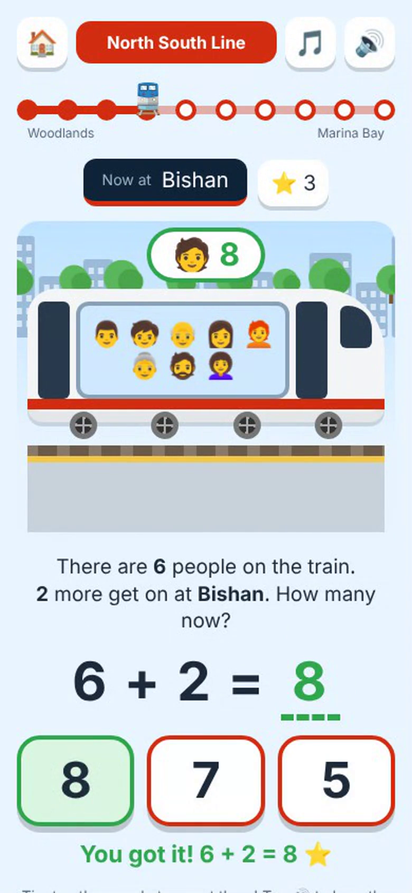

# 🚆 MRT Math Express

A Singapore MRT math game for kids around age 6: single-digit addition and subtraction, with every number 10 or less.

**Play:** open `index.html` in any browser (phone, tablet or computer). No install or internet needed. On a phone or tablet, use **Add to Home Screen** to get an MRT train icon.

**Watch:** [30-second gameplay video](media/mrt-math-express-gameplay.mp4)

## How it plays
1. Pick an MRT line: NS, EW, NE, CC, DT or TE, with every station on the line, in order.
2. Pick **➕ Get on** (adding), **➖ Get off** (taking away) or **🔀 Both**.
3. Tap **📍** by the train to open the map and tap the station to start from (and, from the middle of a line, which way to go).
4. At the bottom of the start screen, a train pulls in beside a railway signal. The light goes red, then amber, then green. On green, tap **GO** (or the train): it toots and drives off. Picking a different line sends a train in that line's colour pulling in, and the signal starts again from red.
5. The doors close and the train speeds out of the station. You ride up front in the driver's cab: tunnels rush past underground, and outside you ride high up on the viaduct above the roads, trees and HDB flats. The train pulls into the next station, shown in 3D, and passengers get on or off. Answer the sum to ride on.
6. Ride to the end of the line to win. Getting it right on the first try earns ⭐. Riding to the end of a line earns its 🏅.

Made for young kids:
- Big buttons with only 3 answers to choose from
- Tap the passengers to count them (a number appears on each one)
- When the train stops, passengers walk to the doors and get on (or step off and walk away waving) one at a time, while a counter says how many: ➕ 1, 2, 3. Then the question appears, and kids can count everyone in the train.
- 🔊 reads the question aloud, since many 6-year-olds are still learning to read
- Wrong answers are gentle: "try again", then a count-on or count-back hint
- No timers and no losing
- At interchanges (like Bishan or Dhoby Ghaut), choose to stay on or change trains, and keep riding across the network
- Tap 🗺️ during a ride to see the whole MRT map and where the train is
- Surprises along the way: count the birds, balloons, butterflies or cats for a 🎁
- Real underground and above-ground stations: the train goes into tunnels and comes out under the open sky where the real MRT does, and underground platforms look indoor
- Day and night and changing weather: the ride starts at the real time of day, moves on every 6 stations (morning, afternoon, sunset, night), and the weather (sunny, cloudy, rain, thunderstorm) changes every 3–5 stations
- Gentle background music. One 🔊 button turns all sound (music, voice and sound effects) on or off. It's an original tune written in code, not the real MRT audio. It gets quieter while the voice reads the question.
- Play time for grown-ups: tap ⚙️ on the start screen (it asks a grown-up sum first) to set 10–30 minutes a day (15 minutes unless you change it, or Off). A ⏱️ clock counts down at the top while riding, the sky turns from morning to night as time runs out, the train says "2 more stops", then it goes to sleep until tomorrow. Reopening the game doesn't reset it. For a lock that can't be got round, also use iPhone Screen Time.

## More game ideas
- **Fare gate / EZ-Link top-up:** pay a fare with 1¢, 5¢ and 10¢ coins (number bonds to 10).
- **Number bond doors:** the train has 10 seats and 6 are filled. How many are empty?
- **Interchange quest:** solve a sum to pick the right line at City Hall, Dhoby Ghaut or Bishan.
- **Missing number:** 4 + ? = 7 ("some people got on. How many?").
- **Platform race:** answer before the train doors close (an optional timer for older kids).
- **Station sticker book:** collect a sticker for every station visited, then fill a map of the whole network.
- **Build-a-train:** each correct answer adds a carriage, up to a 6-car train.
- **Parent dashboard:** show which number facts a child keeps missing.
